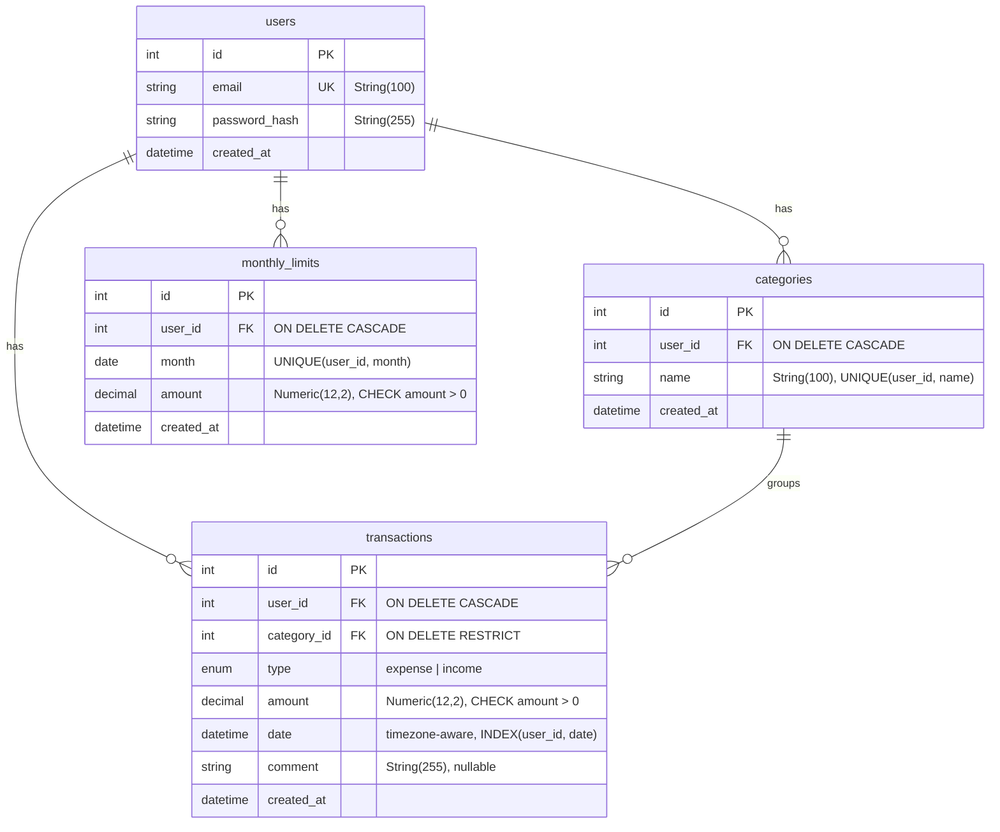

# Spendlog

[](https://github.com/lenyadev/spendlog/actions/workflows/ci.yml)

REST API для учёта личных финансов: операции, категории, месячный лимит, отчёты по категориям.
Учебный проект для портфолио.

**Стек:** Python 3.14, FastAPI, PostgreSQL 16, SQLAlchemy 2.0 (async), Alembic, Pydantic v2 / pydantic-settings, JWT, Argon2, loguru, uv, ruff, pytest, Docker Compose, GitHub Actions.

## Возможности

- Регистрация и вход, JWT access token
- Категории расходов и доходов: CRUD, имя уникально в пределах пользователя
- Операции: CRUD, фильтры по типу, категории и периоду, пагинация
- Месячный лимит: установка, остаток и процент использования за текущий месяц
- Отчёт: суммы по категориям за период
- Изоляция данных: каждый пользователь видит только свои записи
- Структурные JSON-логи с `request_id`, единый ответ `500` без внутренних деталей

## Статус

Этапы 0–6 из [PLAN.md](PLAN.md) завершены: API, миграции, тесты. Идёт этап 7 (качество и деплой), деплой на VPS запланирован. Следующий шаг: клиент на Svelte (этапы 8–14). Описание проекта в [PROJECT.md](PROJECT.md).

## Запуск локально

Нужны: [uv](https://docs.astral.sh/uv/), Docker (Docker Desktop или OrbStack).

```bash
git clone https://github.com/lenyadev/spendlog.git
cd spendlog
cp .env.example .env
docker compose up --build -d
docker compose exec app alembic upgrade head
```

- API: http://localhost:8000
- Swagger UI: http://localhost:8000/docs
- PostgreSQL с хоста: `localhost:5433` (внутри Compose приложение ходит на `db:5432`)

`uv sync` нужен только для разработки (тесты, линтер).

Проверка:

```bash
curl http://localhost:8000/health
curl http://localhost:8000/health/db
```

## Примеры API

Эндпоинты кроме `/auth/register`, `/auth/login` и `/health*` требуют заголовок `Authorization: Bearer <token>`.
Ответы ниже сокращены, значения `id` и даты зависят от ваших данных.

**1. Регистрация**

```bash
curl -X POST http://localhost:8000/auth/register \
  -H "Content-Type: application/json" \
  -d '{"email": "anna@example.com", "password": "strongpass1"}'
```

```json
{"id": 1, "email": "anna@example.com"}
```

**2. Вход.** Эндпоинт принимает форму (`application/x-www-form-urlencoded`), поле `username` это email.

```bash
curl -X POST http://localhost:8000/auth/login \
  -d "username=anna@example.com&password=strongpass1"
```

```json
{"access_token": "eyJhbGciOi...", "token_type": "bearer"}
```

Сохраните токен в переменную (нужен `jq`, либо скопируйте значение вручную):

```bash
TOKEN=$(curl -s -X POST http://localhost:8000/auth/login \
  -d "username=anna@example.com&password=strongpass1" | jq -r .access_token)
```

**3. Категория**

```bash
curl -X POST http://localhost:8000/categories \
  -H "Authorization: Bearer $TOKEN" \
  -H "Content-Type: application/json" \
  -d '{"name": "Продукты"}'
```

```json
{"id": 1, "name": "Продукты"}
```

**4. Операция.** Поле `date` обязательно с часовым поясом (`Z` или смещение).

```bash
curl -X POST http://localhost:8000/transactions \
  -H "Authorization: Bearer $TOKEN" \
  -H "Content-Type: application/json" \
  -d '{"type": "expense", "amount": "1500.00", "date": "2026-11-10T12:00:00Z", "category_id": 1, "comment": "Магазин"}'
```

```json
{"type": "expense", "amount": "1500.00", "date": "2026-11-10T12:00:00Z", "category_id": 1, "comment": "Магазин", "id": 1}
```

**5. Список операций с фильтрами и пагинацией**

```bash
curl -G http://localhost:8000/transactions \
  -H "Authorization: Bearer $TOKEN" \
  --data-urlencode "type=expense" \
  --data-urlencode "date_from=2026-11-01T00:00:00Z" \
  --data-urlencode "limit=10" \
  --data-urlencode "offset=0"
```

```json
{"items": [{"id": 1, "type": "expense", "amount": "1500.00", "...": "..."}], "total": 1, "limit": 10, "offset": 0}
```

Параметры: `type`, `category_id`, `date_from`, `date_to`, `limit` (1–100, по умолчанию 50), `offset`.

**6. Месячный лимит.** `month` приводится к первому числу месяца.

```bash
curl -X POST http://localhost:8000/limits \
  -H "Authorization: Bearer $TOKEN" \
  -H "Content-Type: application/json" \
  -d '{"month": "2026-11-01", "amount": "30000.00"}'
```

Изменить сумму: `PUT /limits` с тем же телом. Состояние за текущий месяц (границы месяца считаются в UTC):

```bash
curl http://localhost:8000/limits/current -H "Authorization: Bearer $TOKEN"
```

```json
{"month": "2026-11-01", "limit": "30000.00", "spent": "1500.00", "remaining": "28500.00", "percent_used": "5.00"}
```

Если лимит на месяц не задан, `limit`, `remaining` и `percent_used` равны `null`.

**7. Отчёт по категориям**

```bash
curl -G http://localhost:8000/reports/categories \
  -H "Authorization: Bearer $TOKEN" \
  --data-urlencode "date_from=2026-11-01" \
  --data-urlencode "date_to=2026-11-30" \
  --data-urlencode "type=expense"
```

```json
{"items": [{"category_id": 1, "category_name": "Продукты", "total": "1500.00"}], "total": "1500.00"}
```

### Ошибки

Все ошибки приходят в виде `{"detail": ...}`.

| Код | Когда |
| --- | --- |
| 401 | Нет токена, токен неверный, неверный email или пароль |
| 404 | Запись не найдена или принадлежит другому пользователю |
| 409 | Дубль (email, категория, лимит на месяц), удаление категории с операциями |
| 422 | Ошибка валидации (поле `detail` содержит список проблем) |
| 500 | Необработанная ошибка, текст исключения в ответ не попадает |

Денежные суммы передаются и возвращаются строками, чтобы не терять точность.

## Схема БД



## Конфигурация

Переменные в `.env` (шаблон в `.env.example`):

| Переменная | Описание |
| --- | --- |
| `APP_NAME` | Название приложения |
| `APP_ENV` | Окружение (`development`) |
| `APP_VERSION` | Версия |
| `DATABASE_URL` | Строка подключения к PostgreSQL |
| `TEST_DATABASE_URL` | Строка подключения к тестовой БД `spendlog_test` (только для pytest) |
| `POSTGRES_USER` | Имя пользователя PostgreSQL (для контейнера) |
| `POSTGRES_PASSWORD` | Пароль пользователя PostgreSQL (для контейнера) |
| `POSTGRES_DB` | Имя основной БД (для контейнера) |
| `SECRET_KEY` | Секретный ключ для подписи JWT |
| `ACCESS_TOKEN_EXPIRE_MINUTES` | Срок жизни access token в минутах (по умолчанию 30) |
| `LOG_LEVEL` | Уровень логов: `DEBUG`, `INFO`, `WARNING`, `ERROR` (по умолчанию `INFO`) |

## Логи

Приложение пишет по одной JSON-записи на запрос в stdout. Поля запроса (`method`, `path`, `status_code`, `duration_ms`, `request_id`) лежат в `record.extra`. Запросы к `/health*` с успешным ответом пишутся на уровне `DEBUG`, ошибки и остальные запросы на `INFO`. Необработанное исключение логируется на уровне `ERROR` с трейсбеком.

## Разработка

```bash
make check   # ruff check, ruff format --check, pytest
make fix     # ruff format и ruff check --fix
make test    # pytest -v
```

Тесты используют отдельную БД `spendlog_test` и не трогают рабочую. <!-- TODO: допиши, как создаётся spendlog_test -->

CI (GitHub Actions) запускает ruff и pytest на каждый push и pull request в `main`.

## Структура репозитория

```
spendlog/
  src/spendlog/     # models, schemas, routers, crud, security, settings, db
  migrations/       # Alembic: окружение и версии миграций
  tests/            # pytest
  Dockerfile        # многоступенчатая сборка, процесс не от root
  docker-compose.yml
  PLAN.md  PROJECT.md
```

## Деплой

Запланирован: VPS, HTTPS через Caddy, резервное копирование БД. Живая ссылка появится здесь.
