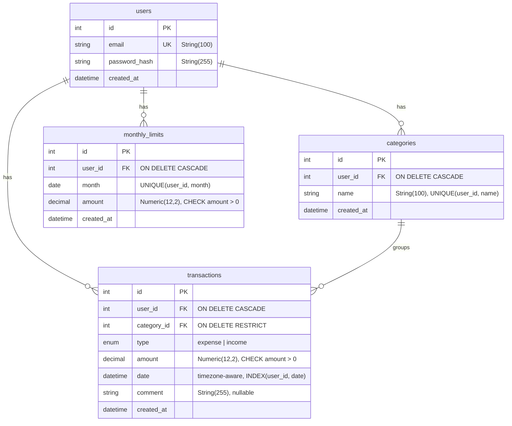

# Spendlog

REST API для учёта личных финансов: операции, категории, месячный лимит, отчёты.
Учебный проект для портфолио.

**Стек:** Python, FastAPI, PostgreSQL, SQLAlchemy 2.0 (async), Alembic, uv, ruff, pytest.

## Статус

Этап 1. Миграция создаёт все таблицы, `downgrade` откатывает без ошибок, тесты не трогают рабочую БД. Остальное по [PLAN.md](PLAN.md), описание проекта в [PROJECT.md](PROJECT.md).

## Схема БД




## Запуск локально

Нужны: Python, [uv](https://docs.astral.sh/uv/), Docker (OrbStack).

```bash
git clone https://github.com/lenyadev/spendlog.git
cd spendlog
cp .env.example .env
uv sync
docker compose up --build
```

- API: http://localhost:8000
- Swagger: http://localhost:8000/docs

## Проверка

```bash
curl http://localhost:8000/health
curl http://localhost:8000/health/db
```

## Разработка

Тесты идут в отдельную БД `spendlog_test` (в том же контейнере Postgres). Создать один раз:

```bash
docker compose exec db sh -c 'psql -U "$POSTGRES_USER" -d postgres -c "CREATE DATABASE spendlog_test;"'
```

```bash
uv run ruff check .
uv run ruff format .
uv run pytest -v
```

CI (GitHub Actions) запускает ruff и pytest на каждый push и pull request в `main`.

## Конфигурация

Переменные в `.env` (шаблон в `.env.example`):

| Переменная | Описание |
| --- | --- |
| `APP_NAME` | Название приложения |
| `APP_ENV` | Окружение (`development`) |
| `APP_VERSION` | Версия |
| `DATABASE_URL` | Строка подключения к PostgreSQL |
| `TEST_DATABASE_URL` | Строка подключения к тестовой БД `spendlog_test` (только для pytest) |
| `POSTGRES_USER` | Имя пользователя PostgreSQL (для контейнера) |
| `POSTGRES_PASSWORD` | Пароль пользователя PostgreSQL (для контейнера) |
| `POSTGRES_DB` | Имя основной БД (для контейнера) |
